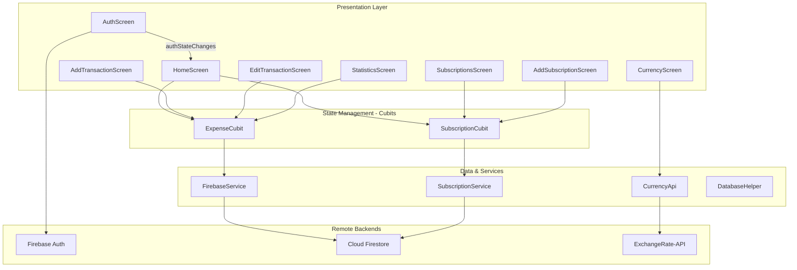

# AI Handoff & Continuity Guide

> **Target Audience:** Future AI assistants and senior engineers continuing development or refactoring on `personal_expense_tracker`. Read this document first to understand the architectural invariants, conventions, gotchas, and roadmap without having to re-audit the project.

---

## 1. Project Mission and Architectural Essence

`personal_expense_tracker` is a personal finance tracker Flutter mobile application targeting Android and iOS. Its core functions are:
1. Recording income and expense transactions in real-time.
2. Managing recurring subscriptions (Netflix, Spotify, gym, rent) with predictive upcoming bill alerts.
3. Visualizing expense allocations through category breakdowns and percentages.
4. Converting amounts against foreign currencies (USD, EUR, GBP, SAR, AED, KWD) relative to the Egyptian Pound (`EGP`) using live REST exchange rates.

---

## 2. Technical Stack Snapshot

* **Language:** Dart `3.5.3+` (Null Safety enforced).
* **Framework:** Flutter `3.x` (Material 3 enabled).
* **State Management:** BLoC / Cubit via `flutter_bloc: ^8.1.6`.
* **Backend:** Firebase (Authentication + Cloud Firestore).
* **HTTP Client:** `dio: ^5.7.0` (ExchangeRate-API).
* **Local DB:** `sqflite: ^2.3.3+1` (dormant/ready for offline synchronization).
* **Theme & UI:** Custom dark palette anchored on forest green (`AppColors.primary = #1B5E20`).

---

## 3. High-Priority Code Conventions & Invariants

### 3.1 Unidirectional Reactive Streams
* State flows downward through Cubit streams (`ExpenseLoaded`, `SubscriptionLoaded`).
* Do **NOT** manipulate state in screen `StatefulWidget` classes for transactions or subscriptions. Always dispatch actions through `context.read<ExpenseCubit>()` or `context.read<SubscriptionCubit>()`.
* Both Cubits manage real-time Firestore stream subscriptions. Any new stream subscriptions **MUST** be stored in a nullable `StreamSubscription?` variable and cleanly cancelled inside the `close()` override.

### 3.2 Authentication & User Isolation
* Cloud Firestore paths are partitioned per-user:
  `/users/{uid}/transactions` and `/users/{uid}/subscriptions`.
* **CRITICAL INVARIANT:** Never use `_auth.currentUser!.uid` directly. Always use the dynamic getters `_transactionsRef` and `_subscriptionsRef` in `FirebaseService` and `SubscriptionService`. When unauthenticated, services must return safe empty defaults (`Stream.value([])`) rather than throwing null check errors.

### 3.3 Numeric Deserialization Rule
* Firestore numbers can be stored as either `int` or `double`.
* **CRITICAL INVARIANT:** Always deserialize numeric fields using `(map['field'] as num?)?.toDouble() ?? 0.0`. Never use `as double`, as that throws `_CastError` whenever an integer is returned.

### 3.4 Package Import Rule
* Never use leading-slash package imports (e.g. `import '/constants/colors.dart';`).
* Always use `package:personal_expense_tracker/...` or clean relative imports (`../../constants/colors.dart`).

---

## 4. Key Architectural Files and Responsibilities

| File Path | Architectural Responsibility | Caution Notes |
|-----------|------------------------------|---------------|
| [lib/main.dart](file:///c:/Users/abori/Desktop/VS Code/Projects/personal_expense_tracker/lib/main.dart) | Application root, `MultiBlocProvider`, and `authStateChanges()` routing. | Do not bypass the `StreamBuilder` when adding splash screens. |
| [lib/business_logic/cubit/expense_cubit.dart](file:///c:/Users/abori/Desktop/VS Code/Projects/personal_expense_tracker/lib/business_logic/cubit/expense_cubit.dart) | Real-time expense & income calculations, balance summation, stream handling. | Ensure `_transactionsSubscription` is cancelled on `close()`. |
| [lib/business_logic/cubit/subscription_cubit.dart](file:///c:/Users/abori/Desktop/VS Code/Projects/personal_expense_tracker/lib/business_logic/cubit/subscription_cubit.dart) | Subscription tracking, monthly cost computation, upcoming dues calculation. | Retain `_cachedUpcoming` so stream emissions don't wipe upcoming list. |
| [lib/data/web_services/firebase_service.dart](file:///c:/Users/abori/Desktop/VS Code/Projects/personal_expense_tracker/lib/data/web_services/firebase_service.dart) | Firestore CRUD for transactions under `/users/{uid}/transactions`. | Must return `Stream.value([])` when user is logged out. |
| [lib/data/web_services/subscription_service.dart](file:///c:/Users/abori/Desktop/VS Code/Projects/personal_expense_tracker/lib/data/web_services/subscription_service.dart) | Firestore CRUD for subscriptions under `/users/{uid}/subscriptions`. | Guard against unauthenticated writes. |
| [lib/data/web_services/currency_api.dart](file:///c:/Users/abori/Desktop/VS Code/Projects/personal_expense_tracker/lib/data/web_services/currency_api.dart) | Dio client for live currency conversion. | 10s timeout configured; rates must be parsed with `as num`. |
| [lib/data/models/subscription_model.dart](file:///c:/Users/abori/Desktop/VS Code/Projects/personal_expense_tracker/lib/data/models/subscription_model.dart) | Billing cycle projection engine (`calculateNextBillingDate`, `isDueSoon`, `isOverdue`). | Keep date comparison normalized to midnight boundaries. |
| [lib/presentation/screens/home_screen.dart](file:///c:/Users/abori/Desktop/VS Code/Projects/personal_expense_tracker/lib/presentation/screens/home_screen.dart) | Main operational dashboard, balance card, transaction history list. | AppBar actions connect to `StatisticsScreen` and `CurrencyScreen`. |

---

## 5. Architectural Map (Mermaid)

---

## 6. Audit Decisions & Changes Made

During the audit, the following key engineering repairs were executed:
1. **Eliminated Cold-Start Crash:** Replaced dangerous `_auth.currentUser!.uid` bang operators with nullable getters returning empty streams when logged out.
2. **Added Reactive Auth Routing:** Wrapped `main.dart` in `StreamBuilder<User?>` on `authStateChanges()`.
3. **Fixed Android Release Manifest:** Added `<uses-permission android:name="android.permission.INTERNET"/>` to `main/AndroidManifest.xml`.
4. **Resolved Memory Leaks:** Subscribed streams in `ExpenseCubit` and `SubscriptionCubit` are now saved and cancelled on `close()`.
5. **Fixed Type Coercion:** Cast amounts with `(val as num?)?.toDouble() ?? 0.0`.
6. **Fixed Billing Overdue Logic:** Date comparisons are normalized to `DateTime(year, month, day)` to prevent false overdue flags on payment day.
7. **Eliminated Keyboard Overflow:** Wrapped form screens in `SingleChildScrollView`.
8. **Linked Unreachable Screens:** Added `StatisticsScreen` and `CurrencyScreen` to `HomeScreen` AppBar.
9. **Assets & Tests:** Declared `assets/icon/` in `pubspec.yaml`, generated standard icons, and wrote real unit tests in `test/widget_test.dart`.

---

## 7. Recommended Next Development Steps

1. **Activate Offline Syncing:** Wire `DatabaseHelper` (SQLite) into `FirebaseService` as a write-through local cache to enable seamless offline transaction registration.
2. **Push Notifications for Subscriptions:** Integrate `flutter_local_notifications` or Firebase Cloud Messaging (FCM) to trigger local OS notifications when `subscription.isDueSoon()` evaluates to true.
3. **Receipt Image Attachment:** Add image picker functionality to `AddTransactionScreen` storing transaction receipt photos in Firebase Cloud Storage.
4. **Biometric Authentication:** Add `local_auth` to support Fingerprint / FaceID unlocking on `AuthScreen`.
5. **Export to CSV / PDF:** Implement a monthly report exporter in `StatisticsScreen`.
