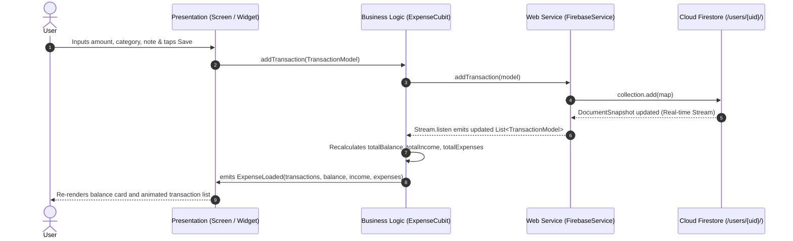
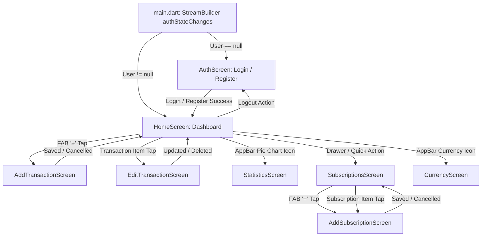

# Application Architecture

## 1. Architectural Pattern Overview

`personal_expense_tracker` implements a **Layered Architecture** with unidirectional data flow powered by **Bloc / Cubit** for reactive state management. The layers are structured as follows:

```
┌─────────────────────────────────────────────────────────────┐
│                    Presentation Layer                       │
│  - Screens: AuthScreen, HomeScreen, StatisticsScreen, etc.  │
│  - Widgets: TransactionItem, CategoryCard, etc.            │
│  - Theming: AppColors, Material 3 Dark Palette              │
└──────────────────────────────┬──────────────────────────────┘
                               │ Dispatches Actions / Reads State
                               ▼
┌─────────────────────────────────────────────────────────────┐
│                   Business Logic Layer                      │
│  - Cubits: ExpenseCubit, SubscriptionCubit                  │
│  - States: ExpenseState, SubscriptionState                  │
│  - Stream Listeners: Auth & Firestore stream subscriptions │
└──────────────────────────────┬──────────────────────────────┘
                               │ Invokes Service Methods
                               ▼
┌─────────────────────────────────────────────────────────────┐
│                        Data Layer                           │
│  - Models: TransactionModel, SubscriptionModel              │
│  - Web Services: FirebaseService, SubscriptionService       │
│  - API Client: CurrencyApi (Dio HTTP REST client)           │
│  - Local DB: DatabaseHelper (SQLite sqflite - offline/dorm) │
└──────────────────────────────┬──────────────────────────────┘
                               │ Network / Disk I/O
                               ▼
┌─────────────────────────────────────────────────────────────┐
│               External Services & Cloud Store               │
│  - Firebase Auth (Email/Password authentication)            │
│  - Cloud Firestore (Multi-tenant document database)         │
│  - ExchangeRate-API (Currency rates for EGP base)           │
└─────────────────────────────────────────────────────────────┘
```

---

## 2. Directory Structure and Responsibilities

```
lib/
├── business_logic/
│   └── cubit/
│       ├── expense_cubit.dart         # Expense & income state management, totals, Firestore stream
│       ├── expense_state.dart         # ExpenseState data holder (transactions, totals, loading)
│       ├── subscription_cubit.dart    # Subscriptions lifecycle, upcoming dues, monthly cost
│       └── subscription_state.dart   # SubscriptionState data holder (list, upcoming, cost, loading)
├── constants/
│   └── colors.dart                   # Global design palette (AppColors: primary, surface, accent)
├── data/
│   ├── local/
│   │   └── db_helper.dart             # SQLite helper (CRUD for offline storage; currently optional/dormant)
│   ├── models/
│   │   ├── subscription_model.dart    # Subscription data model (calculation of billing cycle & dues)
│   │   └── transaction_model.dart     # Transaction data model (type, category, amount, timestamp)
│   └── web_services/
│       ├── currency_api.dart          # Dio client consuming https://api.exchangerate-api.com
│       ├── firebase_service.dart      # Firestore repository for user transactions
│       └── subscription_service.dart  # Firestore repository for user recurring subscriptions
├── presentation/
│   ├── screens/
│   │   ├── add_subscription_screen.dart # Form to create/edit recurring subscriptions
│   │   ├── add_transaction_screen.dart  # Form to register income or expense
│   │   ├── auth_screen.dart             # Authentication form (Login / Register toggle)
│   │   ├── currency_screen.dart         # Currency converter screen using live exchange rates
│   │   ├── edit_transaction_screen.dart # Form to edit/delete an existing transaction
│   │   ├── home_screen.dart             # Main dashboard (balance card, quick actions, history list)
│   │   ├── statistics_screen.dart       # Category-based breakdown & percentage analysis
│   │   └── subscriptions_screen.dart    # Subscriptions overview, upcoming bills, toggle status
│   └── widgets/
│       └── transaction_item.dart        # Reusable ListTile widget displaying a single transaction
└── main.dart                            # Application root, Firebase initialization, auth routing
```

---

## 3. Dependency Injection and Service Wiring

Dependency injection in the project is achieved through **Widget Tree Scoping** using `flutter_bloc`'s `BlocProvider` and `MultiBlocProvider`:

* In [main.dart](file:///c:/Users/abori/Desktop/VS Code/Projects/personal_expense_tracker/lib/main.dart):
  ```dart
  MultiBlocProvider(
    providers: [
      BlocProvider<ExpenseCubit>(
        create: (context) => ExpenseCubit()..getTransactions(),
      ),
      BlocProvider<SubscriptionCubit>(
        create: (context) => SubscriptionCubit()..getSubscriptions(),
      ),
    ],
    child: MaterialApp(...),
  )
  ```
* Both `ExpenseCubit` and `SubscriptionCubit` are instantiated at the root level, making them globally accessible across all screens and dialogs.
* Inside each Cubit, the underlying services (`FirebaseService` and `SubscriptionService`) are instantiated as internal singleton-like dependencies.

---

## 4. Unidirectional Data Flow



---

## 5. Navigation & Screen Flow

The application uses standard imperative Flutter Navigator 1.0 routing with smooth page transitions:



---

## 6. Multi-Tenant Cloud Architecture

Data isolation is guaranteed through per-user subcollections under Firebase Authentication:

```
Cloud Firestore
└── users/ (Collection)
    └── {user_uid}/ (Document)
        ├── transactions/ (Subcollection)
        │   └── {transaction_id}
        │       ├── title: String
        │       ├── amount: double
        │       ├── date: Timestamp
        │       ├── type: String ("income" | "expense")
        │       └── category: String
        └── subscriptions/ (Subcollection)
            └── {subscription_id}
                ├── name: String
                ├── amount: double
                ├── billingCycle: String ("Monthly" | "Yearly")
                ├── startDate: Timestamp
                ├── category: String
                ├── isActive: bool
                └── reminderDays: int
```

Any unauthenticated access safely falls back to empty stream defaults (`Stream.value([])`), preventing unauthorized access or client-side runtime crashes.
