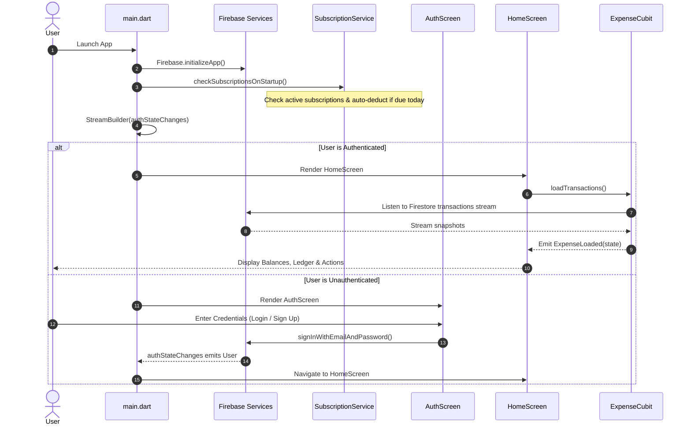

# Project Overview: Personal Expense Tracker

---

## 1. Executive Summary

**Personal Expense Tracker** (`personal_expense_tracker`) is a full-featured, cross-platform personal finance and subscription management mobile application built with **Flutter 3** and **Dart**. The application enables users to log income and expense transactions, organize finances by categories, monitor recurring monthly and yearly subscriptions, analyze spending habits through interactive visualizations, and fetch live foreign exchange rates.

The application adheres to clean architecture principles and separation of concerns, employing **BLoC (Business Logic Component)** via Cubits for reactive state management, **Cloud Firestore** for real-time multi-device cloud synchronization, and **Firebase Authentication** for account management.

---

## 2. Main Purpose & Target Audience

* **Main Purpose:** Empower individuals to achieve financial clarity by keeping accurate track of their daily expenses, recurring subscriptions, and overall financial balance without friction or complex accounting overhead.
* **Target Users:** 
  * Individuals managing personal daily spending and household budgets.
  * Consumers who subscribe to multiple digital services (e.g., Netflix, Spotify, Gym, cloud storage) and need automated tracking to avoid unexpected recurring charges.
  * International travelers or expatriates requiring live foreign exchange conversions against base currencies (e.g., EGP, USD, EUR, SAR).

---

## 3. Core Features

1. **User Authentication & Session Management:**
   * Secure email/password authentication using Firebase Authentication (`signInWithEmailAndPassword`, `createUserWithEmailAndPassword`).
   * Persistent user sessions with reactive authentication state listeners (`authStateChanges()`).
   * Password visibility toggles, input validation, and password strength checks.
2. **Transaction Ledger & Cash Flow Management:**
   * Real-time tracking of both **Income** and **Expense** transactions.
   * Total balance, aggregate income, and aggregate expense cards with dynamic gradient styling.
   * Categorization (Food, Transport, Shopping, Entertainment, Bills, etc.).
   * Creation, modification, and deletion of transactions with date selection and optional notes.
   * Recent transactions quick view (top 4 items) and a full draggable bottom sheet (`DraggableScrollableSheet`) for transaction history.
3. **Automated Recurring Subscription Tracking:**
   * Subscription lifecycle management (Active / Inactive toggle switch).
   * Multiple frequencies: Monthly, Yearly, and Weekly.
   * Billing day selection (Days 1–31) and next billing date tracking.
   * Automated deduction: `SubscriptionService.checkSubscriptionsOnStartup()` automatically generates expense transactions in the ledger on billing days.
   * Due date alert indicators: "Due soon" (within 7 days) and "Overdue" indicators with color-coded badges.
   * Upcoming subscriptions dashboard section for obligations due in the next 7 days.
   * Total projected monthly commitment calculation with normalized frequency aggregation.
4. **Interactive Financial Analytics & Charts:**
   * Interactive pie chart (`fl_chart`) visualizing expense distribution across categories.
   * Percentage allocation calculation and color-coded category legends.
   * Top 3 categories ranked breakdown.
5. **Live Currency Exchange Rates:**
   * Real-time currency exchange rates fetched via REST API using Dio.
   * Base currency: Egyptian Pound (EGP), with conversion rates to USD, EUR, GBP, SAR, AED, and KWD.
   * Pull-to-refresh and network failure handling.

---

## 4. Supported Platforms

| Platform | Support Status | Configuration Path | Notes |
| :--- | :---: | :--- | :--- |
| **Android** | **Primary** | `android/` | Min SDK 21, Target SDK 34, Material 3 theme, internet permissions configured. |
| **iOS** | Supported | `ios/` | Bundle ID `com.example.personalExpenseTracker`, CocoaPods & Flutter integration. |
| **Web** | Supported | `web/` | Firebase Web SDK configuration registered in `firebase_options.dart`. |
| **Windows / macOS / Linux** | Desktop targets present | `windows/`, `macos/`, `linux/` | Desktop scaffolding present in repository; primary focus is mobile UX. |

---

## 5. Technology Stack & Key Dependencies

* **Framework:** Flutter SDK (`>=3.0.0 <4.0.0`)
* **Language:** Dart 3
* **State Management:** `flutter_bloc: ^8.1.6` (Cubit pattern)
* **Cloud Backend & Database:**
  * `firebase_core: ^3.12.1`
  * `firebase_auth: ^5.5.1`
  * `cloud_firestore: ^5.6.5`
* **Local Persistence (Scaffolding):**
  * `sqflite: ^2.3.0`
  * `path: ^1.9.0`
* **Networking / REST API:**
  * `dio: ^5.4.0`
* **Data Visualization:**
  * `fl_chart: ^0.68.0`
* **Internationalization & Formatting:**
  * `intl: ^0.18.1`
* **Icons & Splash:**
  * `cupertino_icons: ^1.0.8`
  * `flutter_launcher_icons: ^0.13.1`
  * `flutter_native_splash: ^2.4.0`

---

## 6. High-Level Execution Flow

---

## 7. Audit Status & Verification

This project overview is based on complete inspection of the active codebase in `lib/`, `android/`, `assets/`, `pubspec.yaml`, and `test/`. All core architectural layers and features described above were verified directly against source implementations.
